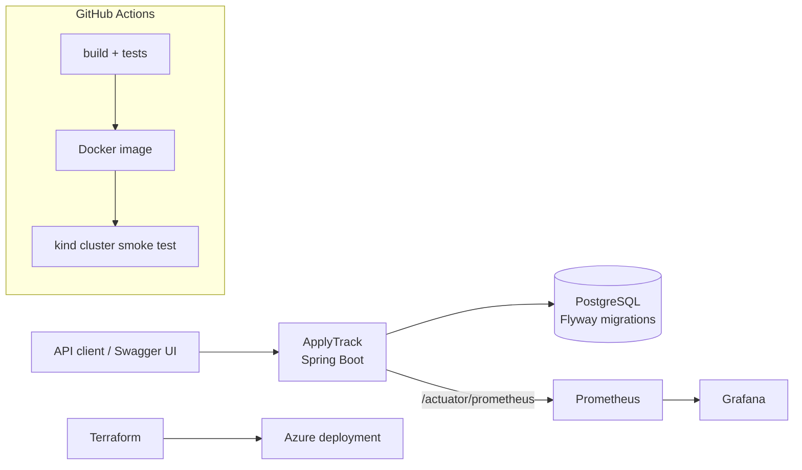

# ApplyTrack

[](https://github.com/Uditp11/applytrack/actions/workflows/ci.yml)

Status: in progress (day 1 skeleton). See the roadmap below.

## Goal

ApplyTrack is a backend API for tracking job applications. It stores companies, job postings, applications, contacts and follow-ups. Each application moves through a fixed set of statuses (DRAFT, APPLIED, INTERVIEW, OFFER, REJECTED, WITHDRAWN), and the service refuses illegal moves with HTTP 409. A stats endpoint will report counts by status and a response rate computed in SQL.

The project is also a practical exercise in the tooling around a Java service: tests with JUnit 5 and Mockito, PostgreSQL with versioned migrations, Docker, GitHub Actions, Kubernetes on a local kind cluster, metrics with Prometheus and Grafana, and an Azure deployment described in Terraform.

All data in this repository is fictional sample data.

## Architecture



Today only the Spring Boot service, its health endpoint, the Docker image and the CI build exist. The rest of the diagram is the target for the milestones below.

Code layout (planned for M1): `controller` (HTTP only), `service` (business rules and the status state machine), `repository` (Spring Data), `domain` (entities), `dto` (request and response records, so entities never leave the API).

## Roadmap

- [ ] **M1** Entities, Flyway migrations, repositories, services with the status state machine, controllers, DTOs, validation, RFC 7807 error responses. Mockito unit tests and Testcontainers integration tests.
- [ ] **M2** `GET /api/stats` with a SQL aggregate query and its indexes. `docker-compose.yml` with the app, PostgreSQL, Prometheus and Grafana. A custom Micrometer metric and a provisioned Grafana dashboard.
- [ ] **M3** Kubernetes manifests with Actuator probes, ConfigMap and a Secret template. A CI job that deploys to a kind cluster and runs a smoke test.
- [ ] **M4** Terraform for an Azure deployment that stays within the free tier, plus a teardown script.
- [ ] **M5** Measured results in this README and an OpenAPI screenshot.

## How to run

You need Java 21. Maven itself is not required, because the repository ships the Maven wrapper (`mvnw`), which downloads the right Maven version on first use.

```bash
# Run the tests and build the jar
./mvnw verify

# Start the service
./mvnw spring-boot:run

# In another terminal
curl http://localhost:8080/actuator/health
# {"status":"UP"}
```

With Docker:

```bash
docker build -t applytrack .
docker run --rm -p 8080:8080 applytrack
```

On Windows, use `mvnw.cmd` instead of `./mvnw`.

## Versions

Checked on 2026-10-18:

| Component | Version | Note |
|---|---|---|
| Java | 21 (LTS) | Java 25 is the newest LTS; 21 is still supported and is the JDK used locally |
| Spring Boot | 3.5.16 | Latest 3.x release. Spring Boot 4.1 is the current line; 3.5 open source support ended on 2026-06-30 |
| Maven | 3.10.0 | Through the Maven wrapper |
