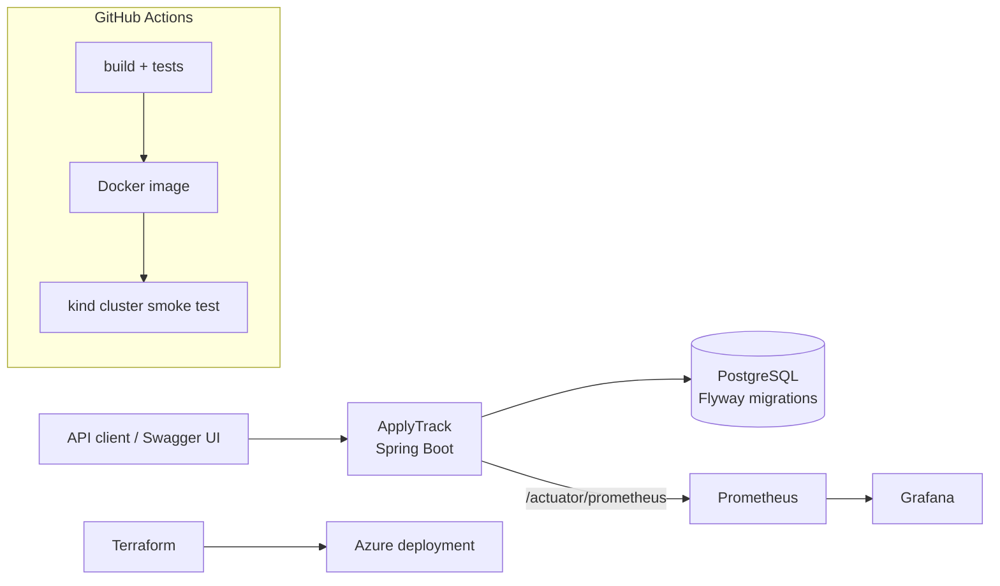

# ApplyTrack

[](https://github.com/Uditp11/applytrack/actions/workflows/ci.yml)

Status: in progress. Done: the REST API with PostgreSQL storage (M1), statistics, metrics and the docker compose stack (M2), and Kubernetes manifests with a CI deployment to a kind cluster (M3). The Azure deployment (M4) is written and checked, but has not been deployed yet. See the roadmap below.

## Goal

ApplyTrack is a backend API for tracking job applications. It stores companies, job postings, applications, contacts and follow-ups. Each application moves through a fixed set of statuses (DRAFT, APPLIED, INTERVIEW, OFFER, REJECTED, WITHDRAWN), and the service refuses illegal moves with HTTP 409. A stats endpoint reports counts by status and a response rate computed in SQL.

The project is also a practical exercise in the tooling around a Java service: tests with JUnit 5 and Mockito, PostgreSQL with versioned migrations, Docker, GitHub Actions, Kubernetes on a local kind cluster, metrics with Prometheus and Grafana, and an Azure deployment described in Terraform.

All data in this repository is fictional sample data.

## Architecture



The service, PostgreSQL, Prometheus, Grafana, the Docker image, the Kubernetes manifests and the CI jobs (build, compose, kind, terraform) exist today. The Terraform for Azure exists and passes `terraform validate`; it has not been applied to a real Azure subscription yet.

Code layout under `src/main/java/io/github/uditp11/applytrack`:

- `controller`: HTTP only. Request validation, status codes, and one exception handler that turns errors into problem details.
- `service`: business rules and transactions, including the status state machine checks.
- `repository`: Spring Data JPA interfaces.
- `domain`: JPA entities and the `ApplicationStatus` enum.
- `dto`: request and response records, so entities never leave the API.

The schema lives in `src/main/resources/db/migration` and is applied by Flyway at startup.

## Roadmap

- [x] **M1** Entities, Flyway migrations, repositories, services with the status state machine, controllers, DTOs, validation, RFC 7807 error responses. Mockito unit tests and Testcontainers integration tests.
- [x] **M2** `GET /api/stats` with a SQL aggregate query and its indexes. `docker-compose.yml` with the app, PostgreSQL, Prometheus and Grafana. A custom Micrometer metric and a provisioned Grafana dashboard.
- [x] **M3** Kubernetes manifests with Actuator probes, ConfigMap and a Secret template. A CI job that deploys to a kind cluster and runs a smoke test.
- [ ] **M4** Terraform for an Azure deployment that stays within the free tier, plus a teardown script. Written and validated in CI; not deployed yet.
- [ ] **M5** Measured results in this README and an OpenAPI screenshot.

## How to run

You need Java 21 and a PostgreSQL database. Maven is not required: the repository ships the Maven wrapper (`mvnw`), which downloads the right Maven version on first use.

```bash
# A local PostgreSQL in Docker, matching the default connection settings
docker run -d --name applytrack-db -p 5432:5432 \
  -e POSTGRES_DB=applytrack -e POSTGRES_USER=applytrack -e POSTGRES_PASSWORD=applytrack \
  postgres:17-alpine

# Run the tests and build the jar
./mvnw verify

# Start the service (Flyway creates the tables on first start)
./mvnw spring-boot:run

# In another terminal
curl http://localhost:8080/actuator/health
# {"status":"UP","components":{"db":{"status":"UP"}, ...}}
```

To use another database, set `DB_URL`, `DB_USER` and `DB_PASSWORD`, for example `DB_URL=jdbc:postgresql://db.example.com:5432/applytrack`.

Tests that need a database start their own PostgreSQL with Testcontainers. Without Docker those tests are skipped; CI runs all of them.

With Docker for the app as well (`host.docker.internal` reaches the database on the host with Docker Desktop):

```bash
docker build -t applytrack .
docker run --rm -p 8080:8080 -e DB_URL=jdbc:postgresql://host.docker.internal:5432/applytrack applytrack
```

On Windows, use `mvnw.cmd` instead of `./mvnw`.

API documentation: http://localhost:8080/swagger-ui (OpenAPI JSON at `/v3/api-docs`).

### The whole stack with docker compose

```bash
docker compose up --build
```

| Service | URL |
|---|---|
| ApplyTrack | http://localhost:8080 (Swagger UI at `/swagger-ui`) |
| Prometheus | http://localhost:9090 |
| Grafana | http://localhost:3000, dashboard "ApplyTrack" (viewing needs no login; admin password `admin` unless `GRAFANA_ADMIN_PASSWORD` is set) |

Prometheus scrapes `/actuator/prometheus` every 15 seconds. Grafana starts with the Prometheus datasource and the dashboard already provisioned from `grafana/`. With the stack running, `scripts/compose-smoke.sh` creates sample data and checks that the counter reached Prometheus and that Grafana has the dashboard; CI runs the same script on every push. `docker compose down -v` removes everything, including the database volume.

### On Kubernetes with kind

[kind](https://kind.sigs.k8s.io/) runs a Kubernetes cluster inside Docker. You need Docker, kind and kubectl.

```bash
kind create cluster --name applytrack
docker build -t applytrack:ci .
kind load docker-image applytrack:ci --name applytrack

kubectl apply -f k8s/namespace.yaml
kubectl -n applytrack create secret generic applytrack-db \
  --from-literal=DB_USER=applytrack --from-literal=DB_PASSWORD='choose-a-password'
kubectl apply -k k8s/
kubectl -n applytrack rollout status deployment/applytrack

kubectl -n applytrack port-forward service/applytrack 8080:80
# in another terminal
scripts/smoke.sh

kind delete cluster --name applytrack
```

`k8s/` holds a namespace, a ConfigMap with the database URL, a demo PostgreSQL (its storage is temporary, fine for a test cluster only), and the app: a Deployment with two replicas and a Service. `k8s/secret.template.yaml` only shows the shape of the database Secret; the real Secret is created with `kubectl create secret` and never stored in the repository. CI runs the same steps (with a random password) on every push to main and on pull requests.

### On Azure (written, not deployed yet)

`terraform/` describes an Azure deployment chosen to fit the free offers: Azure Container Apps on the consumption plan, scaled to zero when idle, and Azure Database for PostgreSQL Flexible Server on the B1ms size with 32 GB (free for 12 months for new accounts). There is no container registry (the image comes from GitHub Container Registry) and no Log Analytics workspace, because both are billed. Logs are still visible with `az containerapp logs show --follow`.

Cost: idle costs nothing, and normal demo use stays inside the monthly free grant of Container Apps. The worst case is not zero: the app is public, and if outside traffic kept one replica busy all month it would go past the free grant (a few tens of dollars, taken from the Azure credit). The app allows at most one replica, a resource group budget e-mails on the first spend (Azure checks budgets with up to a day of delay), and the stack is meant to be removed after each demo. The database firewall allows Azure services, protected by a random 32-character password and TLS; a production setup would use a private network.

CI checks the configuration on every push (`terraform fmt -check`, `terraform init -backend=false`, `terraform validate`) without logging in to Azure. Nothing has been planned or applied against a real subscription yet.

To deploy, once:

1. Log in with `az login` and run `scripts/azure-bootstrap.sh <owner>/<repository>`. It checks that the region offers the free database size, creates a storage account for the Terraform state, and creates a managed identity that GitHub Actions can use through OpenID Connect, so no Azure password or key is stored anywhere.
2. Save the values it prints as GitHub repository secrets.
3. Run the "Deploy to Azure" workflow once with `apply`. The first run stops after pushing the image, because GitHub makes new packages private: make the package public (your profile, Packages, applytrack, Package settings, Change visibility) and run it again.

From then on, `apply` builds and pushes the image, runs `terraform apply` and smoke tests the app. `destroy` (or `scripts/teardown.sh` on a laptop, with `TF_STATE_RESOURCE_GROUP`, `TF_STATE_STORAGE_ACCOUNT` and `TF_VAR_subscription_id` set) deletes everything Terraform created. The bootstrap resources stay until `az group delete --name applytrack-tfstate-rg`.

## Using the API

Create a company, a posting and an application, then move the application along:

```bash
curl -s -H 'Content-Type: application/json' -d '{"name":"Northwind Analytics"}' localhost:8080/api/companies
curl -s -H 'Content-Type: application/json' -d '{"companyId":1,"title":"Backend Developer","location":"Frankfurt"}' localhost:8080/api/postings
curl -s -H 'Content-Type: application/json' -d '{"postingId":1}' localhost:8080/api/applications
# "status":"DRAFT"

curl -s -H 'Content-Type: application/json' -d '{"status":"APPLIED"}' localhost:8080/api/applications/1/transitions
curl -s -H 'Content-Type: application/json' -d '{"status":"INTERVIEW"}' localhost:8080/api/applications/1/transitions
```

An illegal move is refused:

```bash
curl -s -H 'Content-Type: application/json' -d '{"status":"DRAFT"}' localhost:8080/api/applications/1/transitions
```

```json
{"type":"about:blank","title":"Illegal status transition","status":409,
 "detail":"Cannot move application 1 from INTERVIEW to DRAFT","instance":"/api/applications/1/transitions"}
```

`GET /api/applications/1/transitions` returns the history, oldest first.

Statistics:

```bash
curl -s localhost:8080/api/stats
```

```json
{"total":4,
 "byStatus":{"DRAFT":1,"APPLIED":1,"INTERVIEW":1,"OFFER":0,"REJECTED":1,"WITHDRAWN":0},
 "applied":3,"responded":2,"responseRate":0.6667}
```

`applied` counts applications that ever reached APPLIED, `responded` the ones among them that ever reached INTERVIEW or OFFER, and `responseRate` is their ratio (`null` until something has been applied).

Every status change also increments the Prometheus counter `applytrack_status_transitions_total{from="APPLIED",to="INTERVIEW"}`.

| Resource | Endpoints |
|---|---|
| Companies | `GET/POST /api/companies`, `GET/PUT/DELETE /api/companies/{id}` |
| Postings | `GET/POST /api/postings` (`?companyId=`), `GET/PUT/DELETE /api/postings/{id}` |
| Contacts | `GET/POST /api/contacts` (`?companyId=`), `GET/PUT/DELETE /api/contacts/{id}` |
| Applications | `GET/POST /api/applications` (`?status=`), `GET/PUT/DELETE /api/applications/{id}` |
| Status changes | `POST /api/applications/{id}/transitions`, `GET /api/applications/{id}/transitions` |
| Follow-ups | `GET/POST /api/follow-ups` (`?applicationId=`, `?done=`), `GET/PUT/DELETE /api/follow-ups/{id}` |
| Statistics | `GET /api/stats` |

## Design decisions

- An application can move DRAFT to APPLIED, APPLIED to INTERVIEW or REJECTED, INTERVIEW to OFFER or REJECTED, and from any of DRAFT, APPLIED or INTERVIEW to WITHDRAWN; every other move, including staying on the same status, is refused with 409. The rule table sits on the `ApplicationStatus` enum, so a parameterized test checks all 36 pairs without Spring or a database.
- `PUT /api/applications/{id}` edits only the notes. A status only changes through `POST .../transitions`, so the rules cannot be bypassed.
- Each status change is a row in `status_transition`. The response rate counts applications that ever reached INTERVIEW, even if they were rejected later, and the current status alone cannot answer that. The stats query reads this history in one pass with `bool_or` per application and `count(*) filter (...)` on top. Because it reads every row, PostgreSQL scans the table; the indexes added with it serve the filtered lookups instead (`?status=` and one application's history), as `EXPLAIN` on 5,000 applications shows.
- The status change counter is incremented by a listener that runs after the transaction commits, so a change that is rolled back is never counted.
- One application per posting, unique company names, and no deleting a company that still has postings are constraints in the Flyway migration. The API reports them as 409 without exposing SQL. Hibernate only validates the schema; it never changes it.
- Errors are RFC 7807 problem details: every error response has the same JSON shape (`type`, `title`, `status`, `detail`), and validation errors add an `errors` object with one message per field.
- Applications carry a version number (optimistic locking). When two requests change the same application at the same time, the later save fails with a 409 instead of overwriting the first.
- Kubernetes probes use Spring Boot's health groups. Liveness (`/actuator/health/liveness`) does not check the database, because a failing liveness probe restarts the pod and a database outage would then restart every pod for nothing. Readiness (`/actuator/health/readiness`) does check the database, so a pod that lost its connection stops receiving traffic until it is back. A startup probe gives the JVM and Flyway up to two minutes before liveness starts counting.

## Versions

Checked on 2026-10-18:

| Component | Version | Note |
|---|---|---|
| Java | 21 (LTS) | Java 25 is the newest LTS; 21 is still supported and is the JDK used locally |
| Spring Boot | 3.5.16 | Latest 3.x release. Spring Boot 4.1 is the current line; 3.5 open source support ended on 2026-06-30 |
| Maven | 3.10.0 | Through the Maven wrapper |
| PostgreSQL | 17 | `postgres:17-alpine` in tests and CI |
| Flyway | 11.7.2 | Managed by Spring Boot |
| springdoc-openapi | 2.9.1 | The 2.x line is the one built for Spring Boot 3.5 |
| Testcontainers | 1.21.4 | Managed by Spring Boot |
| Prometheus | 3.15.0 | `prom/prometheus:v3.15.0` in docker compose |
| Grafana | 13.2.3 | `grafana/grafana:13.2.3` in docker compose |
| kind | 0.33.0 | Through `helm/kind-action@v1.15.0` in CI |
| Terraform | 1.16.5 | With the `hashicorp/azurerm` provider 5.8.0 |
